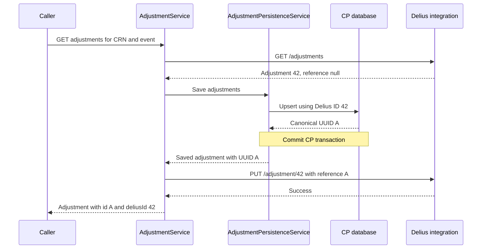

# 0008 - Give Delius adjustments a stable Community Payback reference for deletion

Date: 2026-11-16

## Status

Proposed. The reference synchronisation described below is implemented in this PR. Supporting deletion when there is no Community Payback creation event remains outstanding in the current implementation.

## Context

Adjustments can originate in either Delius or the Community Payback service (CP). A user viewing adjustments in CP needs to be able to delete an eligible adjustment regardless of where it was created.

The APIs use two different identifiers:

| Identifier | Example | Purpose |
| --- | --- | --- |
| Delius adjustment ID | `42` | Numeric identifier returned by Delius. The integration API can use it to update the adjustment's reference. |
| CP adjustment reference | UUID `A` | CP's adjustment identity, stored in Delius as `reference`. The CP and integration delete endpoints accept this UUID. |

`A` and `B` in the examples below represent different UUIDs.

The relevant endpoints are:

| API | Endpoint | Identifier used |
| --- | --- | --- |
| CP | `GET /admin/offenders/{crn}/unpaid-work-details/{deliusEventNumber}/adjustments` | CRN and event number |
| CP | `DELETE /admin/adjustments/{communityPaybackId}` | CP UUID |
| Community Payback and Delius integration | `GET /adjustments?crn={crn}&eventNumber={eventNumber}` | CRN and event number |
| Community Payback and Delius integration | `PUT /adjustment/{id}` | Numeric Delius ID; the request body supplies the UUID reference |
| Community Payback and Delius integration | `DELETE /adjustments/{reference}` | UUID reference |

### Why adjustments created in Delius could not be deleted

When CP creates an adjustment, it generates a UUID and includes it in the request to Delius. CP also records a creation event. Delius can subsequently resolve that adjustment by its CP reference.

An adjustment created directly in Delius can have a numeric Delius ID and a null `reference`. It has no CP adjustment entity and no CP creation event. Previously, returning that adjustment from the list endpoint did not establish a CP reference. The UI therefore had no UUID to use with the CP delete endpoint, and the integration delete endpoint could not identify the adjustment by a CP reference either.

There is a second dependency in the current CP delete implementation: `AdjustmentService.deleteAdjustment` looks up an `AdjustmentEventEntity` using the supplied UUID and returns `NotFound` if no event exists. Resolving the missing reference is necessary, but an imported adjustment entity alone does not satisfy this event lookup.

### Existing CP data also needs to remain usable

Some adjustments were created through CP before adjustment entities were introduced. CP has their creation events and, where applicable, the original appointments, but has no corresponding row in `adjustments`.

Other adjustments already have an adjustment entity. Delius can still return a missing or different reference for the same numeric adjustment ID, for example after an earlier reference update failed. Refreshing these records must preserve their established CP identity.

The implementation must distinguish these cases:

| What Delius returns | What CP already stores | Required import behaviour |
| --- | --- | --- |
| Adjustment with no reference | Neither an adjustment entity nor a creation event | Create an adjustment entity, establish its UUID in Delius, and return that UUID to the caller. |
| Adjustment with a reference | A matching historical CP creation event, but no adjustment entity | Create the entity with that reference and recover the appointment from the creation event. |
| Adjustment with an existing entity's reference | An adjustment entity | Refresh the existing adjustment. |
| Adjustment with a missing or different reference | An entity with the same numeric Delius adjustment ID | Refresh the existing entity, retain its UUID, and repair the reference in Delius. |

## Decision

Use the adjustment list retrieval to establish and refresh a durable mapping between the numeric Delius adjustment ID and a CP UUID. Persist that mapping before updating the reference in Delius.

Once an adjustment entity exists, its UUID is the canonical CP reference for that Delius adjustment. Incoming Delius data can refresh its fields, but a missing or changed reference must not replace its identity.

Use the existing UUID-based delete contract. Completing deletion for imported adjustments requires the CP delete flow to support an adjustment entity without requiring a historical CP creation event. That part of the decision is described separately below because it is not implemented by reference synchronisation alone.

### 1. Import adjustments during list retrieval

`AdjustmentService` retrieves adjustments from Delius and delegates persistence to `AdjustmentPersistenceService`.

The persistence service resolves adjustment reasons by Delius reason code. For records whose returned reference matches a CP `CREATE` event, it recovers the event's appointment. A `DELETE` event is not used as evidence of the original appointment.

For an adjustment created directly in Delius, importing it creates an `AdjustmentEntity`. Importing does not publish an `AdjustmentCreatedEvent` or manufacture a CP creation event. CP has discovered an existing adjustment; it has not created a new adjustment in Delius.

Import happens before the CP service applies filtering, sorting and pagination. All adjustments returned by the Delius call are reconciled, including adjustments outside the requested page or reason filter.

### 2. Resolve identity atomically by numeric Delius ID

The `adjustments` table has a primary key on its CP UUID and a unique constraint on `delius_adjustment_id`.

`AdjustmentEntityUpsertRepository` uses PostgreSQL's conflict handling:

```sql
INSERT INTO adjustments (...)
VALUES (...)
ON CONFLICT (delius_adjustment_id) DO UPDATE SET
    -- Refresh adjustment fields; preserve the existing primary key.
    ...
RETURNING id;
```

This is illustrative SQL. The repository contains the complete statement.

For a first import, the proposed UUID comes from the Delius reference when one is present, otherwise CP generates one. If the numeric Delius ID already exists, the database updates that row and returns its existing UUID. The service uses the returned UUID in the response and in subsequent calls to Delius.

For example, CP already stores Delius adjustment `42` under UUID `A`. A later response from Delius has no reference, so entity mapping proposes UUID `B`. The upsert matches `delius_adjustment_id = 42`, refreshes the row under `A`, and returns `A`. It does not insert a second row under `B` or fail on the unique constraint. The same rule applies when Delius returns a different reference explicitly.

A lookup followed by an ordinary insert would address sequential refreshes but still allow two concurrent first imports to both observe that no entity exists. Conflict handling makes the identity decision in the database, including when another request has inserted the row concurrently.

If two GET requests initially propose `A` and `B` for an unreferenced Delius adjustment, both persistence calls return the UUID of the single stored row. Both requests consequently send the same reference to Delius.

The repository also preserves an existing appointment when the incoming adjustment supplies no appointment. Writes are ordered by numeric Delius ID to give overlapping imports a consistent row-lock order. The returned list retains the original Delius order before any requested sorting is applied.

A retried CP creation can receive a new numeric Delius ID for the same CP reference. The repository first updates that mapping where the new numeric ID is not already assigned to another CP row, then performs the upsert. Both operations participate in the persistence transaction.

### 3. Commit CP state before updating Delius

The retrieval sequence is:



Both `getAdjustments` overloads use `Transactional.TxType.NOT_SUPPORTED`. This suspends any caller transaction for the retrieval and reference synchronisation. The separate persistence service starts a database transaction and returns through Spring's transaction proxy only after it has committed successfully.

This is the reason for the separate service. Annotating a private method, or calling another method on the same service instance, would not establish the required transaction boundary through Spring's proxy. Flushing JPA changes would send statements to the database but would not commit them.

The persistence service flushes pending JPA changes before executing JDBC statements so that related records in a shared creation transaction are available. The flush is separate from the commit boundary used by GET imports.

CP compares the saved UUID with the reference returned by Delius. It sends `PUT /adjustment/{numericId}` whenever the reference is missing or different. If the references already match, there is no reference update.

### 4. Retry reference synchronisation using the committed UUID

The CP database and Delius do not share a transaction. The implementation therefore permits a recoverable intermediate state: CP has committed UUID `A`, but Delius has not yet stored it.

| Failure point | Persisted CP state | Behaviour on a subsequent GET |
| --- | --- | --- |
| Persistence or commit fails | Changes from that persistence transaction are rolled back; existing committed rows remain | No reference PUT has been made by that request. Retry importing from Delius. |
| CP commits, then the reference PUT fails | The adjustment entity and its UUID remain committed | Match by numeric Delius ID, retain the UUID, and retry the PUT. |
| CP commits, then the process stops before the PUT | The adjustment entity and its UUID remain committed | Repair the reference using the stored UUID. |
| Delius accepts the PUT, but CP receives an error or times out | The CP mapping remains committed; Delius may already have the reference | Read Delius again. Skip the PUT if it matches, otherwise resend the same UUID. |
| Several adjustments are saved, then a later PUT fails | The whole CP persistence batch remains committed; some Delius references may have been updated | Update only references that still differ. |

A reference update failure propagates from the GET request. The service does not return a successful list response while treating the reference update as complete.

There is no outbox or scheduled retry worker in this change. Recovery depends on a later retrieval reaching `AdjustmentService`. An outbox can be introduced if synchronisation must complete without another read.

### 5. Preserve CP creation and historical appointment behaviour

When CP creates a new adjustment, `createAdjustment` keeps its existing transaction. Its call to the persistence service joins that transaction using the default `REQUIRED` behaviour. Persistence is not forced into an independent transaction during creation.

This preserves rollback of local adjustment changes, creation events and related task changes together. The existing compensating handling for a failed CP creation in Delius remains relevant; see [ADR 0005](0005-avoiding-orphaned-ndelius-entities.md).

For historical CP adjustments, a matching creation event supplies the original appointment and UUID when the adjustment entity is first populated. Later refreshes retain the entity's UUID and preserve its appointment when the Delius response omits the reference.

There is a limit to historical recovery in the current implementation: the first import looks up creation events by the UUID reference returned by Delius. If Delius omits that reference before an adjustment entity exists, the implementation does not recover the old creation event or its appointment by numeric Delius ID. The stable identity guarantee applies once the adjustment entity exists; it does not imply that every missing historical link can be reconstructed.

## How this addresses deletion, and what remains

This PR fixes the missing-reference prerequisite for deletion:

1. A Delius-created adjustment can be retrieved using its CRN and event number, even though its reference is initially null.
2. CP establishes a durable UUID mapping for it and stores that reference in Delius.
3. The list response supplies that UUID as the adjustment's `id`.
4. The caller can address the adjustment using the UUID-based API, and the Delius integration can resolve the same UUID for its delete endpoint.

**The current CP delete handler still prevents an imported adjustment without a creation event from being deleted.** It calls `adjustmentEventEntityRepository.findByIdOrNull(adjustmentId)` and returns `NotFound` before calling Delius when that event is absent. The import intentionally creates no such event.

Completing the user-visible fix requires the following delete-path work:

- Resolve the adjustment from its CP adjustment entity, with an explicit compatibility path for historical CP adjustments if they can be deleted before being imported.
- Use the entity's canonical UUID when calling the existing Delius delete endpoint.
- Adapt deletion auditing and domain-event construction to represent an imported adjustment that has no original CP creation event. The current `AdjustmentDeletedEvent` and event factory depend on an `AdjustmentEventEntity`, and the deleted-domain-event mapper expects a referenced creation event. Changing the lookup alone is insufficient.
- Preserve existing task and audit behaviour for adjustments originally created through CP. Do not publish a fabricated CP creation event merely to satisfy the delete handler.
- Define removal or marking of the local adjustment entity after successful deletion, including how failures between Delius deletion and local completion are reconciled. The current list import does not remove CP entities simply because Delius no longer returns them.

Until that integration and its tests are implemented, the PR should be described as establishing stable references for deletion, rather than as complete support for deleting Delius-created adjustments through CP.

## Alternatives considered

### Change deletion to accept a numeric Delius ID

This would provide a direct identifier for adjustments created in Delius, but would require a change to the CP delete contract and support in the integration delete API. Establishing the existing UUID reference keeps identity consistent with adjustments created through CP and with reference-based retrieval.

### Generate a UUID only in the list response

The integration delete endpoint would still have no stored reference to resolve. A newly generated UUID could also change between requests. The mapping must be durable in CP and synchronised to Delius.

### Load existing entities and use ordinary JPA saves

Matching by numeric Delius ID would preserve UUIDs during sequential refreshes. Concurrent first imports would still need database conflict handling, locking or transaction retries. The PostgreSQL upsert handles that contention at the existing unique constraint and returns the canonical identity directly.

### Update Delius before committing CP

Delius could store a UUID whose CP row subsequently rolls back or never commits. A retry might generate another UUID and leave the systems disagreeing about identity. Committing CP first provides a durable reference for retry.

### Add an outbox immediately

An outbox could retain pending reference updates and retry them independently of reads. It would also require delivery, retry and operational handling. The current decision uses synchronous updates and recovery on subsequent reads. Automatic convergence without a later GET remains a possible extension.

## Consequences

The numeric Delius adjustment ID identifies the CP row during refresh. Missing or changed references no longer cause a second entity to be inserted for the same Delius adjustment. Concurrent imports and retries reuse one CP UUID.

Listing adjustments now performs database writes and can update Delius. It can fail because persistence or reference synchronisation fails, even when the initial Delius read succeeded. Repeated reads converge to the same mapping, and reference PUTs stop once Delius returns the stored UUID.

The CP adjustment entity stores the last imported snapshot. Delius remains the source used by the list retrieval for adjustment details. Import is performed when adjustments are read; this change does not perform a full backfill or infer deletions from missing rows in a response.

The persistence implementation uses PostgreSQL-specific SQL and a transaction-aware `JdbcClient` alongside JPA. The existing `adjustments` migration provides the unique Delius ID constraint required by the upsert; reference conflict handling needs no additional schema migration beyond that table definition.

The deletion objective is only complete when the CP event requirement has also been addressed. Keeping that dependency explicit avoids treating successful reference synchronisation as proof of successful deletion.

## Validation

The existing tests cover the implemented reference work through observable database changes and outgoing Delius calls:

| Scenario | Evidence |
| --- | --- |
| Adjustment created in Delius with no CP records | An adjustment entity is saved, its UUID is sent to Delius, and a later refresh updates the same row. |
| Historical CP creation event with an appointment | Import creates the entity with the historical UUID and appointment; a later missing reference retains both and repairs Delius. |
| Reference PUT fails after persistence | The committed entity remains; retry sends the same UUID. |
| Concurrent first imports | Both requests succeed, CP contains one adjustment entity, and both PUTs use its UUID. |
| Delius returns a missing or changed reference | Unit coverage verifies that reference synchronisation sends the UUID returned by persistence. |
| CP creation fails after persistence | The existing creation rollback integration test verifies that the previously committed Delius ID remains. |

The missing end-to-end acceptance test for the deletion objective must start with an adjustment created in Delius and no CP creation event, retrieve its list through CP, then delete it using the UUID returned by CP. It must verify the outgoing reference update and delete, the intended local lifecycle, and a valid deletion audit/domain event without inventing a CP creation event. This case is not demonstrated by the current deletion tests, which seed a CP creation event.

